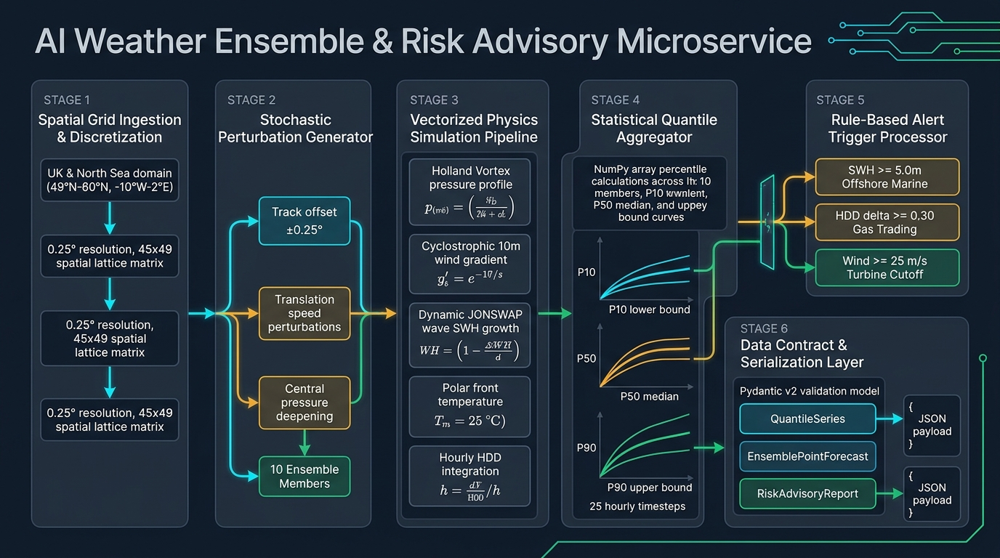
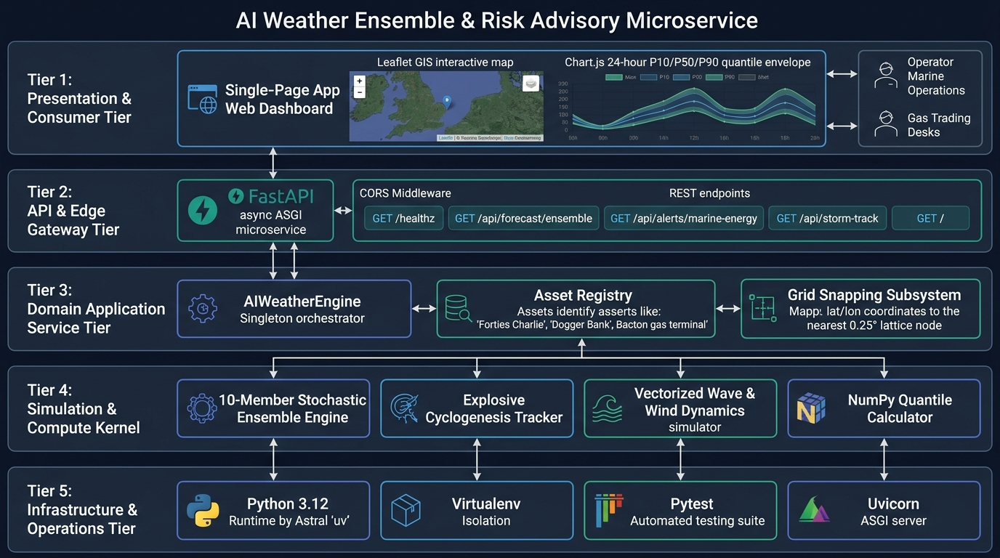

# AI Weather Ensemble & Risk Advisory Microservice

Probabilistic weather ensemble engine and marine/energy risk advisory microservice covering the **UK & North Sea Basin** (49°N to 60°N, -10°W to 2°E, 0.25° grid resolution).

---

## Architecture Overview

```
weather-ai-antigravity/
├── docs/
│   └── diagrams/             # High-resolution workflow diagrams
│       ├── data_engineer_workflow.jpg
│       └── solution_architect_workflow.jpg
├── src/
│   ├── ai_weather_engine.py  # 10-member ensemble simulator & risk advisory logic
│   ├── risk_api.py           # FastAPI service & REST endpoints
│   └── __init__.py
├── web/
│   └── index.html            # Single-page dashboard (Leaflet map + Chart.js ensemble envelope)
├── tests/
│   ├── test_ai_weather_engine.py # Physics & quantile validation tests
│   └── test_risk_api.py          # FastAPI endpoint integration tests
├── pyproject.toml            # Project configuration & dependencies
└── uv                        # uv package & project runner
```

---

## Workflow Diagrams

### 1. Data Engineer Perspective
Pipeline architecture showing grid discretization, 10-member stochastic generation, Holland vortex / JONSWAP wave dynamics, and P10/P50/P90 quantile reduction:


### 2. Solution Architect Perspective
Tiered enterprise architecture spanning presentation (Leaflet/Chart.js), API gateway (FastAPI/Uvicorn), core engine singleton, numerical kernel, and uv containerization:


---

## Key Features

1. **AI Weather Ensemble Engine (`src/ai_weather_engine.py`)**:
   - **Domain**: UK & North Sea basin bounded by 49°N–60°N and -10°W–2°E at 0.25° grid resolution.
   - **10-Member Ensemble**: Generates 24-hour probabilistic trajectories (P10 lower bound, P50 ensemble median, P90 upper bound).
   - **Storm Simulation ('Storm Antigravity')**: Simulates explosive North Sea cyclogenesis with central pressure dropping below 970 hPa, wind ramping past 30 m/s, and Significant Wave Height (SWH) breaching **5.0m** across Central North Sea assets (e.g. Forties Charlie).
   - **Energy Risk**: Captures rapid cold front surges behind the low, driving sharp temperature drops and **Heating Degree Day (HDD) spikes $\ge 0.30$** for natural gas trading.

2. **FastAPI Microservice (`src/risk_api.py`)**:
   - `GET /healthz`: Health status, active storm details, and ensemble configuration.
   - `GET /api/forecast/ensemble`: Snaps arbitrary `lat` & `lon` query coordinates to the nearest 0.25° grid node and returns the 24-hour P10/P50/P90 time series for wave height, wind speed, temperature, pressure, and HDD.
   - `GET /api/alerts/marine-energy`: Returns operational threshold alerts:
     - **Marine Offshore**: SWH $\ge 5.0$m (e.g., Forties Charlie Platform).
     - **Gas Trading**: Heating Degree Day spike $\ge 0.30$ (e.g., UK gas terminals and London demand hub).
     - **Offshore Wind**: High-wind turbine cutoff $\ge 25.0$ m/s.
   - `GET /api/assets`: Catalogue of monitored offshore platforms, wind arrays, and gas terminals.
   - `GET /api/storm-track`: 24-hour storm eye coordinates and central pressure profile for geospatial plotting.
   - `GET /`: Serves the interactive web dashboard.

3. **Web Dashboard (`web/index.html`)**:
   - Interactive Leaflet map displaying domain boundary, storm eye track, and offshore asset markers with live status badges.
   - Real-time Chart.js visualizer showing 24-hour P10/P50/P90 ensemble envelope bands, median trajectories, and operational threshold lines.
   - Responsive KPI metrics cards and filterable alert action cards with clear operational recommendations.

---

## Quickstart

### Running the API & Dashboard
Execute using `uv`:
```bash
uv run uvicorn src.risk_api:app --host 0.0.0.0 --port 8000 --reload
```
Once started, open [http://localhost:8000](http://localhost:8000) in your browser to view the interactive dashboard.

### Running Verification Tests
Execute the pytest suite using `uv`:
```bash
uv run pytest -v
```
